# Bible Institute LMS — Final Architecture & Execution Plan (v3)

> [!IMPORTANT]
> **Scope:** four portals (Institute Admin, Teacher, Student, Super Admin). The Public Website is **postponed to Phase 11** and will not be started until all portals are done and approved by you.
> **Database safety:** no `migrate reset`, `db push --accept-data-loss`, `TRUNCATE`, `DROP` or destructive migrations on any shared database without your explicit written approval. A backup is taken before every approved schema change.

---

## 1. Current State (verified)

| Item | Finding |
| :--- | :--- |
| Workspace `BIBLE-Management` | Empty. No existing code, schema or auth to preserve. |
| `Desktop\bible_institute_lms_updated.html` | Single-file UI prototype with mock data (courses, students, teachers, classes). Nothing is saved; data resets on reload. **Its mock data and screen list will be reused as seed data and a checklist for screens.** |
| Toolchain | Node v24.15, npm 11.12. **No local PostgreSQL (`psql`) and no Docker.** We need a database before migrations can run (see §12). |

---

## 2. System Architecture

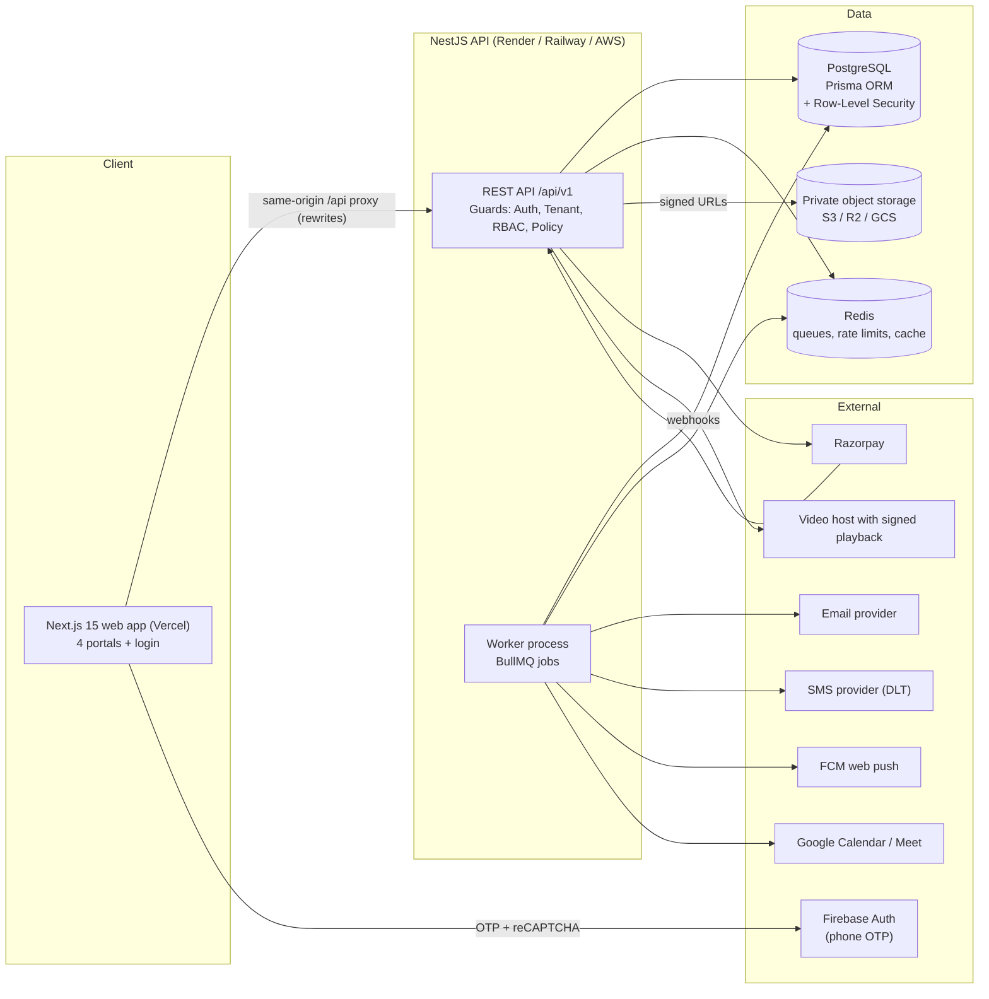

**Rules that keep the layers separate**
- **Next.js** only handles UI, routing and calling the API. It has no database access and no business logic. Its middleware only *redirects* users based on the role claim; the real permission checks happen in NestJS.
- **NestJS** owns all business logic, validation, authorization, payments, file signing and notifications.
- **Same-origin proxy:** Next.js `rewrites` forwards `/api/*` to NestJS, so auth cookies stay first-party (`HttpOnly`, `Secure`, `SameSite=Lax`) even though web and API are hosted separately.
- **Shared package** (`packages/shared`): role/permission constants, Zod schemas and DTO types used by both apps. The API client is generated from NestJS's OpenAPI spec, so there are no hand-written duplicate endpoints.

### 2.1 Repository layout (npm workspaces monorepo)

```
BIBLE-Management/
├─ apps/
│  ├─ api/                     NestJS
│  │  ├─ prisma/               schema.prisma, migrations/, seed/
│  │  ├─ src/core/             config, prisma, tenancy, auth, rbac, audit, health, logging, throttling, queue
│  │  ├─ src/modules/          one folder per domain module (§6)
│  │  └─ test/                 unit, integration, e2e, permission-matrix
│  └─ web/                     Next.js (App Router, TypeScript, Tailwind)
│     ├─ src/app/(auth)/login
│     ├─ src/app/admin/…  teacher/…  student/…  super-admin/…
│     ├─ src/components/ui/    design-system primitives
│     └─ src/lib/api/          generated typed client + TanStack Query hooks
├─ packages/shared/            roles, permissions, zod schemas, types
├─ docs/                       ARCHITECTURE.md, IMPLEMENTATION_PROGRESS.md, DATABASE_SAFETY.md, RUNBOOKS
└─ .github/workflows/ci.yml    lint, typecheck, test (Postgres service), build
```

### 2.2 Technology choices

| Concern | Choice | Why |
| :--- | :--- | :--- |
| Web | Next.js 15, React 19, TypeScript, Tailwind, Radix primitives, Motion (Framer), Recharts, TanStack Query | Premium UI, accessible primitives, lightweight animation |
| API | NestJS 11, class-validator / Zod, Swagger | Modular, testable, guard/interceptor model fits RBAC + tenancy |
| DB | PostgreSQL 16 + Prisma 6 | Relational integrity, RLS support |
| Jobs | BullMQ + Redis | Notifications, reminders, subscription expiry, retention, reconciliation |
| Auth | Firebase phone OTP → API-issued session (JWT access 15 min + rotating refresh cookie) | OTP delivery handled by Firebase; API owns roles and sessions |
| Payments | Razorpay Orders + signature check + webhooks | Required by you |
| Storage | Private bucket (S3/R2/GCS) with short-lived signed URLs | Secure documents |
| Video | Signed-playback video host (Mux / Cloudflare Stream / Bunny Stream), decided in Phase 3 | Signed, expiring HLS streams |

---

## 3. Multi-Tenant Data Isolation (3 layers)

Every institute-owned table has a non-null `instituteId`. Platform-level tables (Plan, PlatformSetting, global User identity) do not.

| Layer | Mechanism | What it stops |
| :--- | :--- | :--- |
| **1. Application** | `TenantContext` (request-scoped) is resolved from the session's *active membership*, never from a request body or query string. A Prisma Client extension **automatically adds `instituteId`** to every `where`, `create` and `upsert` on tenant models and throws if the context is missing. | Developer mistakes and forgotten filters |
| **2. Database integrity** | `@@unique([id, instituteId])` on parent tables, plus **composite foreign keys** `(childFk, instituteId) → (id, instituteId)` on key relations (enrolment→course, submission→assignment, order item→course, etc.) | Rows pointing at another institute's data |
| **3. PostgreSQL RLS** | `ENABLE ROW LEVEL SECURITY` with policy `institute_id = current_setting('app.institute_id')::uuid`. The API runs each request in a transaction with `SET LOCAL app.institute_id`. Super Admin uses a separate DB role with audited bypass. | Any leak that gets past layers 1 and 2 |

**Record-level rules on top of tenancy** (NestJS *policy* services):
- A **teacher** can only touch courses/batches they are assigned to (`CourseInstructor`, `BatchTeacher`).
- A **student** can only access their own records, plus content for courses where they hold an active, unexpired `Enrolment`.
- If a resource belongs to another tenant or the user isn't allowed to see it, the API returns **404, not 403**, so it doesn't reveal that the record exists.

Super Admin permissions use separate `platform.*` permission keys and a separate route prefix (`/api/v1/platform/*`). An Institute Admin can never hold them.

---

## 4. Authentication & Authorization

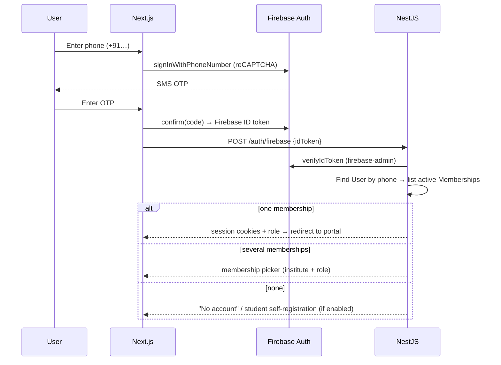

- **Identity model:** `User` (global, unique E.164 phone) → `Membership` (user × institute × role). One person can be a teacher at Institute A and a student at Institute B.
- **Roles:** `SUPER_ADMIN`, `PLATFORM_SUPPORT`, `INSTITUTE_ADMIN`, `ACADEMIC_COORDINATOR`, `FINANCE_OFFICER`, `TEACHER`, `STUDENT`.
- **Permissions:** string keys (`students.read`, `courses.publish`, `payments.refund`…) with a default role→permission map in `packages/shared`. Institutes can override this map (`RolePermissionOverride`). Enforced by the `@RequirePermissions()` guard plus policy services.
- **Sessions:** access JWT valid for 15 minutes, held in memory or an HttpOnly cookie. The refresh token is opaque, rotated on each use and stored as a hash. If an old refresh token is reused, the whole token family is revoked. Sessions can be viewed and revoked.
- **Dev OTP provider:** for local work without Firebase, a fixed test code works **only** when `NODE_ENV !== 'production'` and `AUTH_DEV_OTP=true`. The app refuses to boot in production with this flag on.
- **Passwords:** there are none for normal users. Super Admin can optionally add TOTP 2FA in Phase 10.
- **Rate limits:** OTP verification is limited per phone, per IP and per device. Every attempt is logged in `LoginEvent`.

---

## 5. Complete Database ERD (by domain)

`PK` primary key, `FK` foreign key, `UK` unique. Every table also has `createdAt` and `updatedAt`. Tables marked † also have `deletedAt` (soft delete). Money is stored as **integer paise**.

### 5.1 Platform, Tenancy & Subscriptions

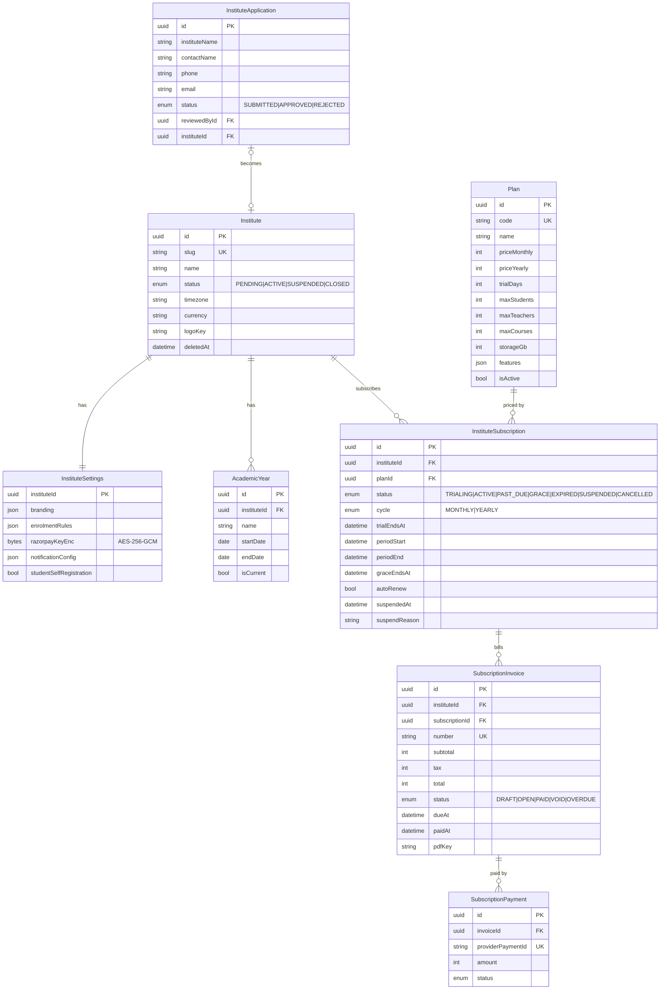

### 5.2 Identity, Access & Profiles

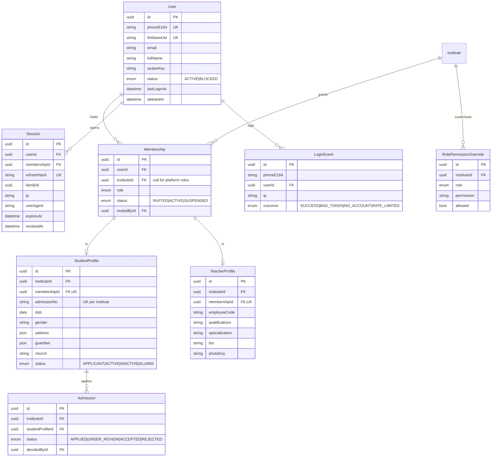

### 5.3 Catalogue, Curriculum & Media

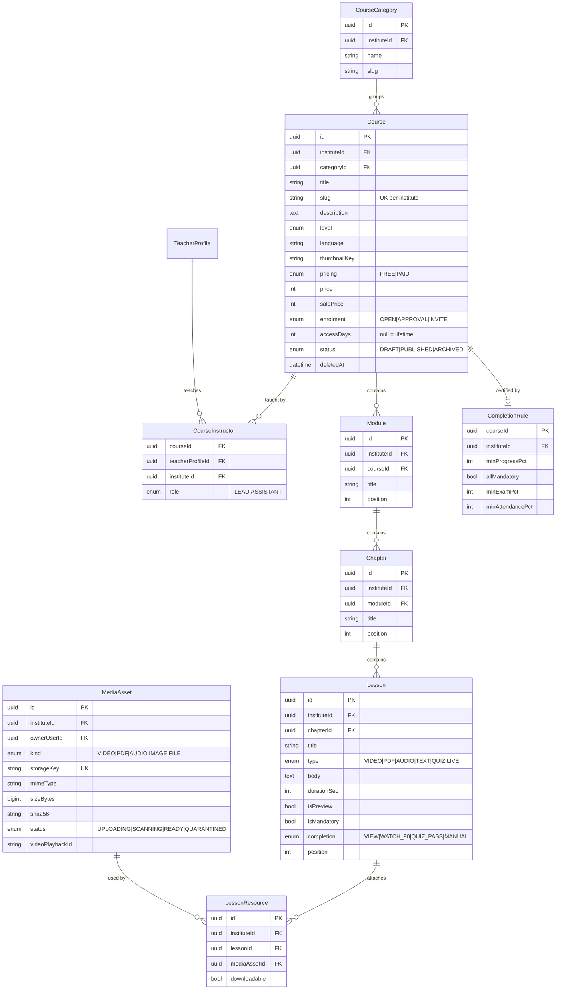

### 5.4 Enrolment, Batches, Live Classes & Attendance

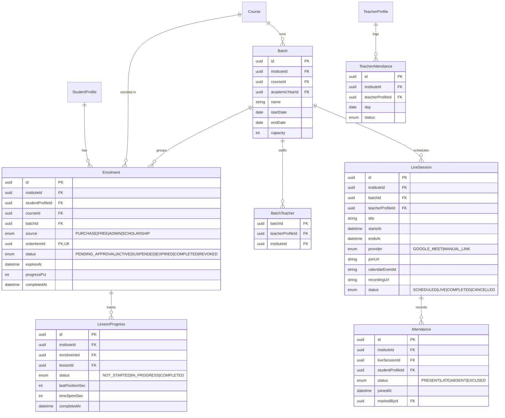

### 5.5 Assessments, Results & Certificates

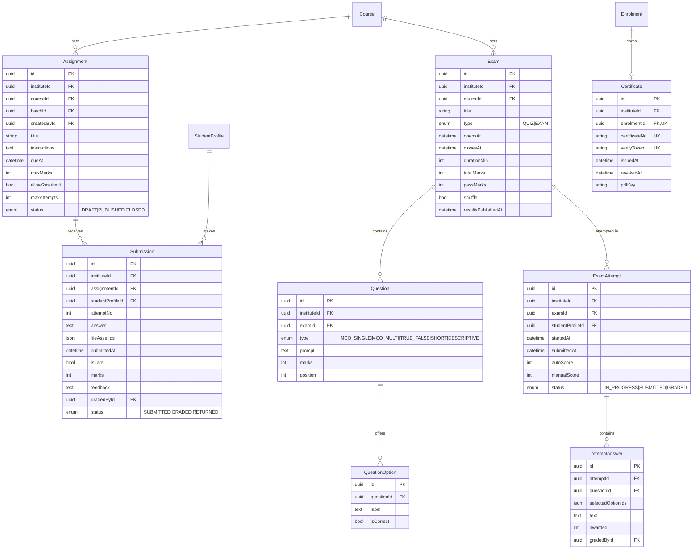

### 5.6 Commerce: Cart, Coupons, Orders, Payments, Refunds

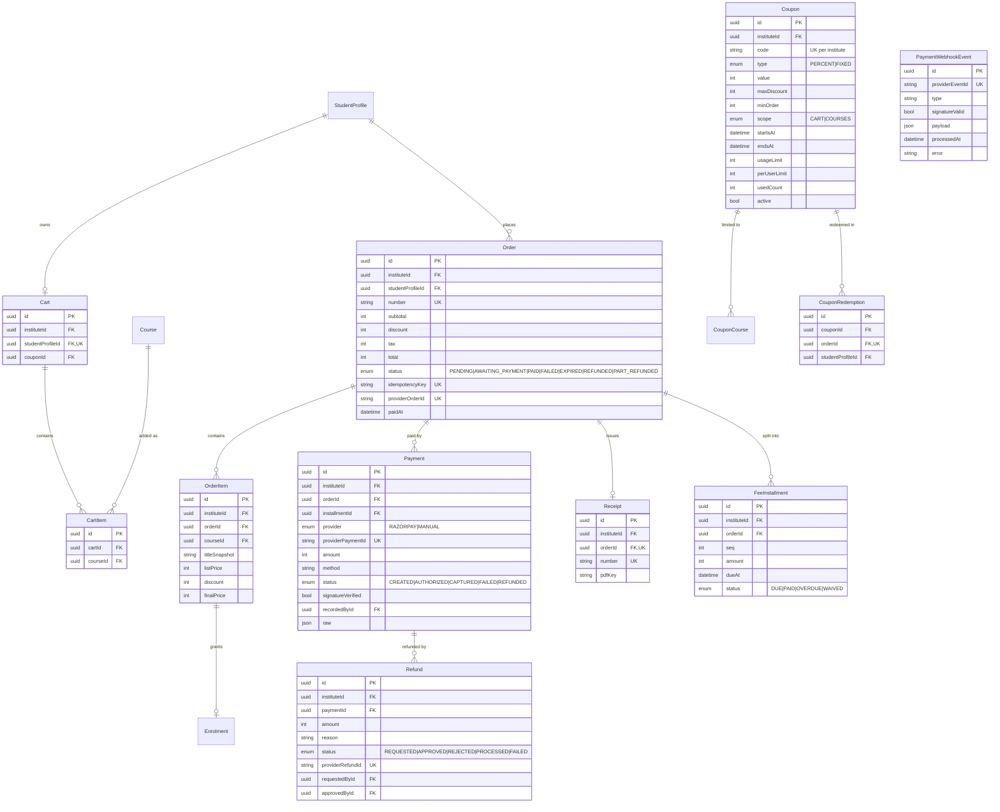

### 5.7 Communication, Notifications & Support

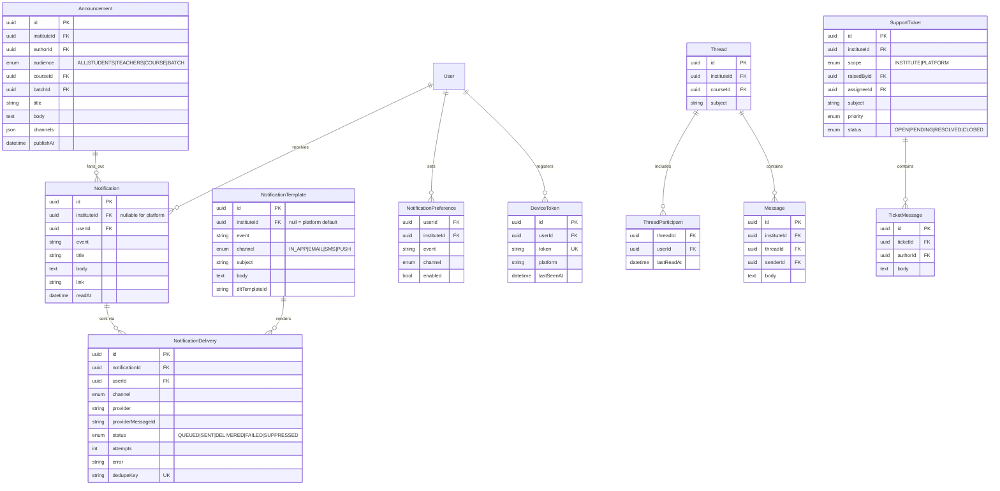

### 5.8 Operations: Audit, Retention, Backups, Integrations

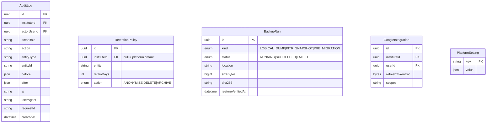

---

## 6. NestJS Module Map & Dependencies

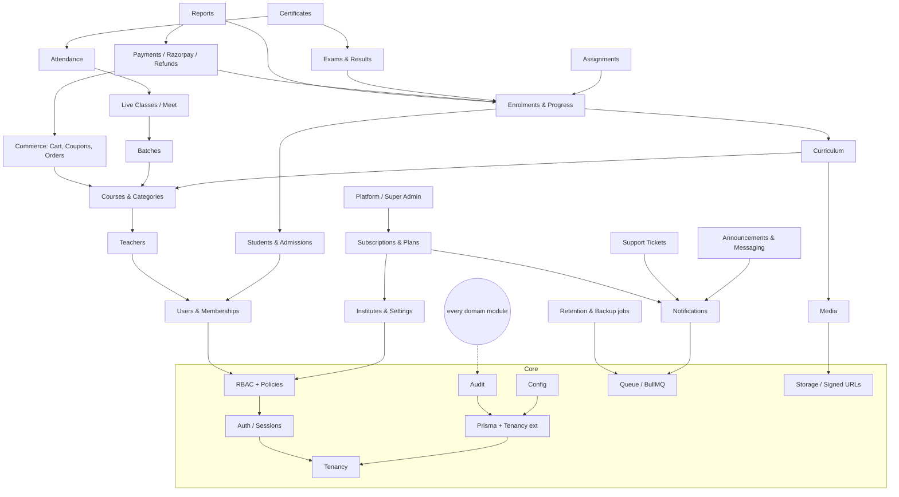

Every module that changes data writes to `AuditLog` through an interceptor, using a declarative `@Audit('course.publish')` decorator.

---

## 7. Course Purchasing (cart → verified enrolment)

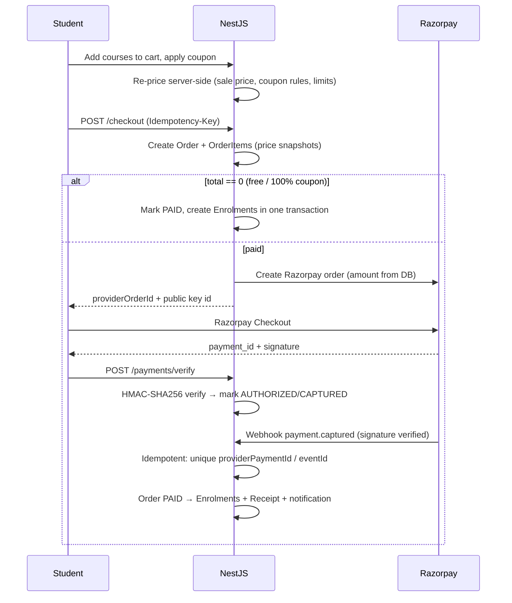

- **Prices are never taken from the client.** The server re-prices the cart at checkout, and that price is what goes into the order.
- An enrolment is created **only** after the server has verified the payment signature or the webhook signature. The webhook is the source of truth. A reconciliation job pulls stuck `AWAITING_PAYMENT` orders from Razorpay every 15 minutes.
- Idempotency is enforced in several places: `Order.idempotencyKey`, `Payment.providerPaymentId`, `PaymentWebhookEvent.providerEventId` and `Enrolment.orderItemId` are all unique.
- **Coupon redemption** happens inside the same transaction that marks the order PAID. Usage limits are checked with a row lock, so a coupon can't be over-used under concurrent checkouts.
- **Refunds:** student requests → admin approves → Razorpay refund API → `refund.processed` webhook → enrolment revoked (configurable) → audit entry.
- **Partial payments:** `FeeInstallment` schedule. Access rules (for example, access while installments are not overdue) are configured per course.
- Secret keys stay in the backend only. Per-institute keys are encrypted at rest with AES-256-GCM, using a key from env/KMS.

---

## 8. Subscription Lifecycle (Super Admin)

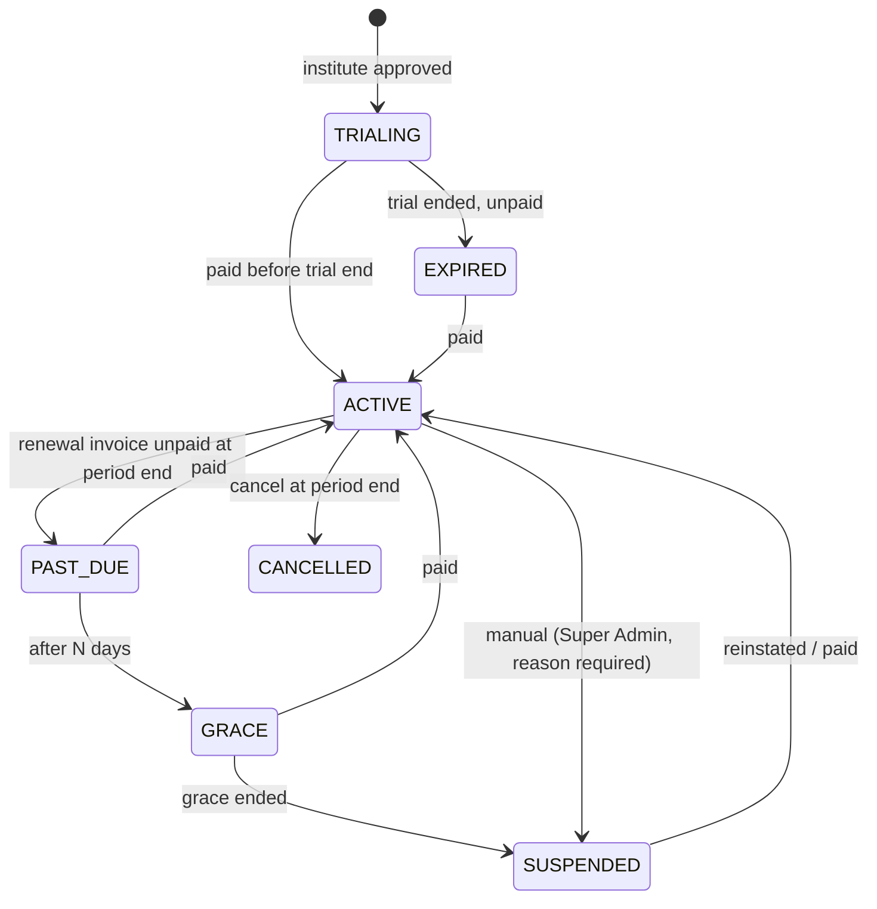

- **Daily jobs:** issue renewal invoices 7 days before period end, send reminders at 7, 3 and 1 days and on the expiry day, move statuses forward, and enforce suspension.
- **Effect of suspension:** institute users get read-only access with a banner, and new enrolments and payments are blocked. Students keep read access to content they already paid for during GRACE. **No data is ever deleted when an institute is suspended.**
- **Plan limits** (students, teachers, courses, storage) are enforced in the API through a `PlanLimitGuard`.
- Invoices get sequential numbers per financial year, with PDF and GST fields.

---

## 9. Secure Video & Document Access

1. All files live in a **private** bucket. Nothing is publicly readable.
2. **Uploads:** API checks permission → issues a presigned PUT (content type and size limits) → client uploads → API verifies size, MIME and magic bytes (optional ClamAV scan) → `READY`.
3. **Access:** `GET /lessons/:id/content` → policy check (active, unexpired enrolment, or preview lesson, or assigned teacher) → signed URL valid for about 5 minutes and tied to the asset.
4. **Video:** HLS through a provider that supports signed playback tokens (short TTL) and domain restriction, plus a dynamic watermark overlay showing the student's name and masked phone.
5. **PDFs:** shown in an in-app pdf.js viewer. Download is offered only when `LessonResource.downloadable` is set.

> [!WARNING]
> No web solution can fully stop screen recording. Signed URLs and watermarks make casual sharing hard and help trace leaks. Full DRM (Widevine/FairPlay) can be added later if you need it, at extra cost.

---

## 10. Notification Pipeline

`Domain event → NotificationService.dispatch(event, recipients, data)` → writes in-app `Notification` rows → checks each user's `NotificationPreference` → queues one BullMQ job per channel → channel workers (Email / SMS / Push) → `NotificationDelivery` row with status and retries (exponential backoff, dead-letter queue).

| Channel | Provider (proposed) | Notes |
| :--- | :--- | :--- |
| In-app | DB + Server-Sent Events | Bell icon, unread count, mark all read |
| Email | Resend / Amazon SES | Templated, with unsubscribe link for non-transactional mail |
| SMS / OTP | OTP through Firebase Auth. Transactional SMS through MSG91 / Twilio | **India requires DLT registration** of sender ID and templates |
| Push | Firebase Cloud Messaging (web push) | Works where the browser supports it. Not available on iOS Safari unless the app is installed as a PWA |

Events include: OTP login, enrolment confirmed, payment success/failure, refund status, class reminder (24 h / 15 min), assignment due/graded, results published, certificate issued, announcement, subscription reminders/suspension.

---

## 11. Backup, Recovery, Audit & Retention

| Area | Policy |
| :--- | :--- |
| **Backups** | Managed Postgres with point-in-time recovery (7–30 days, depending on provider). Plus a nightly encrypted `pg_dump` to a separate bucket/account, kept 30 daily and 12 monthly. Every run is recorded in `BackupRun`. |
| **Pre-migration** | Mandatory snapshot before `prisma migrate deploy` in staging/production. Migrations are reviewed and must be additive. Destructive steps are split out and **need your explicit approval**. |
| **Recovery** | Written runbook with target RPO ≤ 15 min and RTO ≤ 4 h. A **monthly restore drill** into a scratch database is recorded in `restoreVerifiedAt`. |
| **Audit logs** | Append-only. The app's DB role has `UPDATE`/`DELETE` revoked on `audit_log`. Covers logins, role changes, grade changes, payments, refunds, settings, exports and suspensions. |
| **Soft delete** | All user-facing domain records use `deletedAt`. Hard deletion happens only through retention jobs. |
| **Retention** (defaults, configurable) | OTP/login events 180 days; notifications 1 year; audit logs 7 years; financial records kept for the statutory period (**confirm with your accountant**); inactive student PII anonymized on approved erasure requests while financial rows are kept. |
| **Privacy** | Personal data export and erasure workflow, aligned with India's DPDP Act 2023. |

---

## 12. Testing Strategy

| Level | Tooling | Scope |
| :--- | :--- | :--- |
| Unit | Jest | Services: pricing/coupons, subscription state machine, grading, completion rules, permission resolution |
| Integration (DB) | Jest + real Postgres (CI service container, or a dedicated local test DB) | Repositories, Prisma tenancy extension, RLS policies, transactions, idempotency, migrations applied to an empty DB |
| API e2e | Supertest against the Nest app | Every endpoint: success, validation errors, 401/403/404 |
| **Permission matrix** | Generated table-driven tests | For **each endpoint × each role** → expected allow/deny, from one shared matrix file |
| **Tenant isolation** | Dedicated suite | Institute A users try to read/write B's records by ID, list, search and export → must get 404 / empty results |
| Payments | Razorpay test mode + signed webhook fixtures | Duplicate webhooks, bad signatures, amount tampering, out-of-order events |
| Web | Vitest + React Testing Library | Components, forms, hooks |
| Portal e2e | Playwright | Key journeys per portal, desktop + mobile viewports, axe accessibility checks |
| Performance | Lighthouse CI, k6 (Phase 10) | Budgets: LCP < 2.5 s, API p95 < 300 ms on core reads |

**Exit criteria for every phase:** lint, typecheck, unit, integration and e2e all pass. Both apps build. The permission matrix and tenant suites are green. Responsive screens are checked. `IMPLEMENTATION_PROGRESS.md` is updated.

---

## 13. Phase-wise Execution Checklist

### Phase 1 — Foundation
- [ ] Monorepo (npm workspaces), shared ESLint/Prettier/TS config, `.env.example` files
- [ ] NestJS core: Config (validated env), Prisma service + tenancy extension, request context, logging (pino + request IDs), throttling, global validation, error filter, health check, Swagger
- [ ] Full Prisma schema (§5) + first migration (on an empty DB, after you approve the DB) + RLS SQL migration
- [ ] Seed: 1 platform super admin, 1 demo institute, roles, the prototype's courses/teachers/students
- [ ] Auth: Firebase token exchange, dev OTP provider, memberships, membership picker, refresh rotation, logout, `/me`
- [ ] RBAC: permission catalogue, `@RequirePermissions`, policy base classes, audit interceptor
- [ ] Next.js: design tokens, light/dark themes, UI kit (Button, Input, Select, Dialog, Drawer, Tabs, Table, Badge, Card, StatCard, Avatar, Skeleton, EmptyState, Toast, Dropdown, ProgressRing, Chart wrappers), motion presets that respect reduced motion
- [ ] Login (phone → OTP → picker), role routing, 4 portal shells (sidebars, topbar, user menu, collapsible nav, mobile drawer)
- [ ] Tests: auth e2e, tenancy extension, permission-matrix harness. CI workflow
- [ ] Docs: ARCHITECTURE, DATABASE_SAFETY, IMPLEMENTATION_PROGRESS

### Phase 2 — Institute Admin core
- [ ] Dashboard KPIs, charts, recent activity, upcoming classes, quick actions
- [ ] Students: CRUD, admissions pipeline, profile with tabs (academics, enrolments, fees, attendance), search/filter/pagination, CSV import/export
- [ ] Teachers: CRUD, profile, course/batch assignment, workload, teacher attendance
- [ ] Academic years, institute profile/branding, role-permission overrides, in-app notification centre (basic)

### Phase 3 — Courses, Curriculum & Secure Media
- [ ] Categories, course editor (thumbnail, pricing FREE/PAID/sale, enrolment mode, access duration), publish/archive, instructors
- [ ] Curriculum builder Course→Module→Chapter→Lesson→Resource with drag-and-drop reorder
- [ ] Media pipeline: presigned uploads, validation, video provider integration, signed delivery, watermark
- [ ] Completion rules

### Phase 4 — Teacher Portal
- [ ] Dashboard, assigned courses/batches, rosters, content editing within permissions, material upload, announcements, student performance view

### Phase 5 — Student Portal
- [ ] Dashboard (welcome, progress, hours, streak, upcoming classes, pending work, announcements, certificates)
- [ ] In-app course catalogue, course detail, **cart**, free-course enrolment
- [ ] Course player (video/PDF/audio/text, resume position, mark complete, next lesson), progress tracking

### Phase 6 — Assignments, Exams & Results
- [ ] Assignments with attachments, submissions, late flag, resubmission, grading workbench, feedback
- [ ] Exam builder (MCQ/TF/short/descriptive), scheduling, timer, autosave, auto-grading, manual grading, result publishing, analytics

### Phase 7 — Live Classes, Attendance & Communication
- [ ] Google Meet via Calendar API (teacher OAuth), manual-link fallback, reminders, class history, recordings
- [ ] Attendance (bulk mark, join tracking, reports)
- [ ] Full notification pipeline: email, SMS (DLT), web push, preferences, templates. Messaging threads. Support tickets

### Phase 8 — Commerce, Certificates & Finance
- [ ] Multi-course checkout, discounts, coupons, Razorpay orders/verify/webhooks/reconciliation, receipts, installments, manual offline payments, refunds
- [ ] Certificate eligibility engine, PDF generation, unique IDs, `/verify/:token` page, revocation
- [ ] Financial and academic reports with exports

### Phase 9 — Super Admin & Subscriptions
- [ ] Platform dashboard, institute applications (approve/reject), institute profiles, activate/suspend
- [ ] Plans/packages, trials, renewals, expiry, grace, invoices, platform payments, plan-limit enforcement
- [ ] Platform support desk, platform settings, platform audit viewer

### Phase 10 — Hardening & Deployment
- [ ] Security review (OWASP ASVS L2 checklist), Super Admin 2FA, dependency audit, CSP/headers
- [ ] Performance (query indexes, caching, image optimization, bundle analysis), k6 load test
- [ ] Backup automation + restore drill, retention jobs, monitoring/alerts (Sentry, uptime)
- [ ] Staging → production deployment (Vercel + API host + managed Postgres + Redis), runbooks

### Phase 11 — Public Website ⏸ POSTPONED
- Not started until Phases 1–10 are approved.

---

## 14. Decisions Needed From You

| # | Decision | Default if you don't mind |
| :--- | :--- | :--- |
| 1 | **Development database:** no local Postgres/Docker found | Free managed Postgres (Neon or Supabase, Mumbai region). You create it and paste the connection string into `.env` |
| 2 | **Firebase project** for phone OTP | Build with the dev OTP provider now, then plug Firebase in when you share config |
| 3 | **Tailwind version** | Tailwind CSS v4 (current default) |
| 4 | **Student self-registration** by phone | Allowed (needed for purchases). Teachers/admins are invite-only |
| 5 | Payment collection model (Phase 8) | Each institute connects its own Razorpay account. Platform subscriptions use the platform account |
| 6 | Video host (Phase 3) | Decide in Phase 3 after comparing cost |
